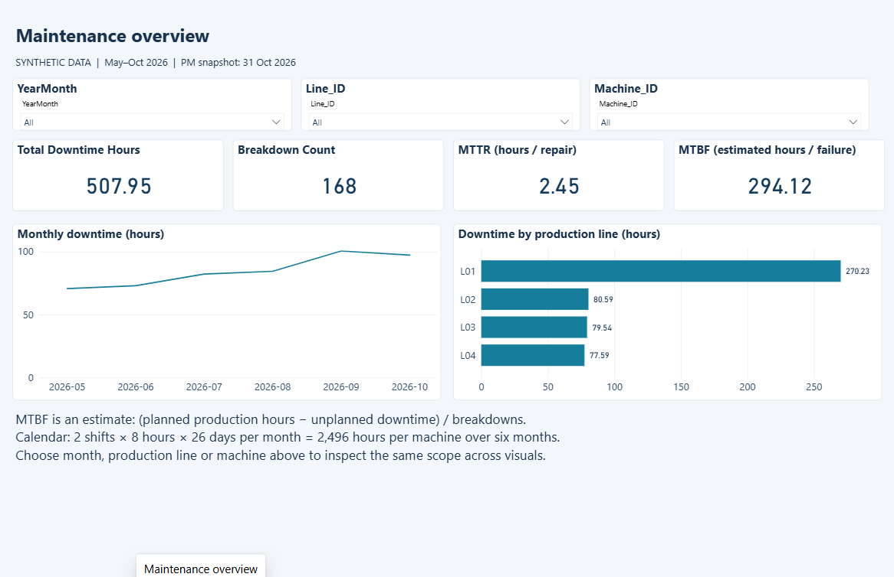
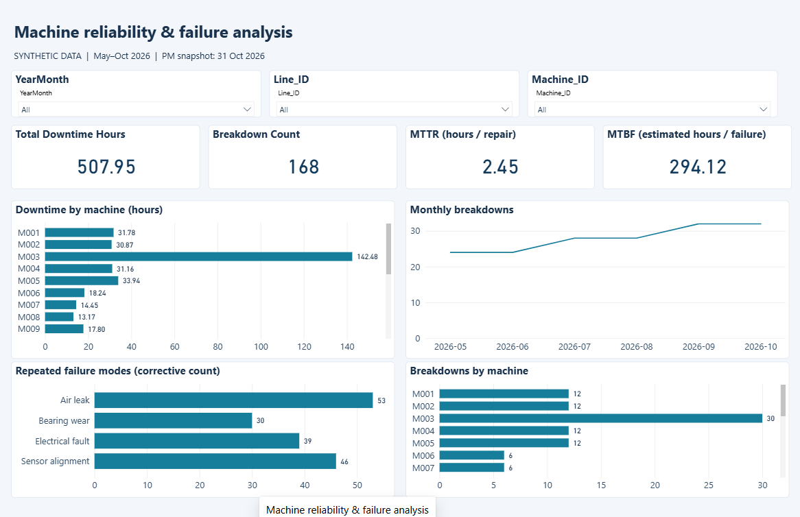
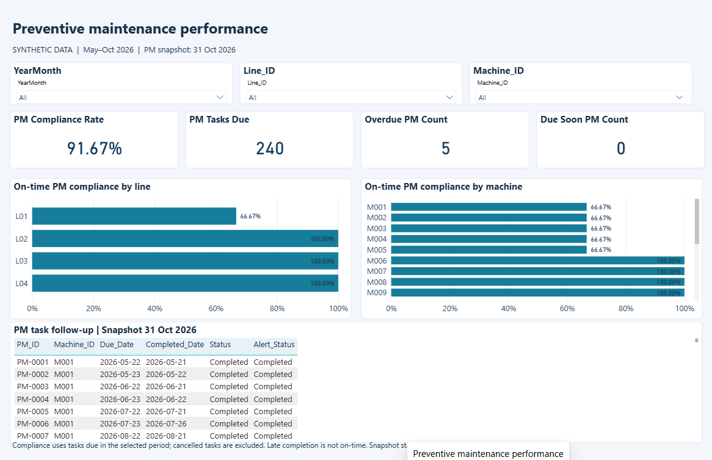

# Maintenance Planning & Downtime Analytics

Dự án portfolio mô phỏng phục vụ thực hành công việc Preventive Maintenance Planning Intern. **Không phải hệ thống hoặc dữ liệu nội bộ Bosch.** Phạm vi áp dụng: tài liệu JD-focused trong thư mục cha và các lựa chọn đã chốt với người dùng.

## Ba file bắt đầu sử dụng

| File | Mục đích |
|---|---|
| [Power BI report](powerbi/Maintenance_Analytics.pbix) | Mở bằng Power BI Desktop; có dữ liệu đã nạp và ba trang tương tác |
| [Excel/VBA workbook](excel/Maintenance_Planner.xlsm) | Nhập/sửa hoạt động, theo dõi PM và xuất CSV |
| [Hướng dẫn workbook](HUONG_DAN_VBA.md) | Cách dùng ba macro và ý nghĩa các trường |

Bản mã nguồn báo cáo: `powerbi/Maintenance_Analytics.pbip` cùng hai thư mục `Maintenance.Report` và `Maintenance.SemanticModel`. Giữ chúng cạnh nhau nếu chỉnh sửa project. Dùng PBIX khi chỉ cần mở và xem báo cáo.

## Kết quả và kiểm chứng

- Nguồn: 20 máy, 4 dây chuyền, kỳ 01/05–31/10/2026; seed 42.
- 691 dòng nguồn = **663 hợp lệ + 28 cách ly (4,05%)**. Dữ liệu hợp lệ gồm 20 máy, 403 hoạt động và 240 nhiệm vụ PM.
- SQL Server thật: `localhost` → `MaintenancePlanningJD`, 4 bảng và 3 view. Có PK/FK/CHECK; nạp lại không trùng: thêm 0, cập nhật 0, bỏ qua 663.
- Power BI đã mở trong Desktop, nạp từ SQL, lưu PBIX và kiểm tra mở lại. **120 tổ hợp máy–tháng, 960 phép đối chiếu DAX với Python đều khớp**; trường hợp không có sự cố trả MTTR/MTBF rỗng.
- 7 bài unittest Python, 7 kiểm thử VBA của bản JD và 3 kiểm tra ràng buộc SQL bằng rollback đều đạt. Bằng chứng trong `tests/` và `outputs/sql_evidence/`.
- Kiểm tra thay đổi dữ liệu: một fixture Inspection trên bản sao CSV xuất từ Excel đi qua Python/SQL và xuất hiện trong model (403 → 404). Đã xóa đúng fixture và xác nhận model về 403. Macro nhập Excel được kiểm thử riêng trên bản sao workbook.

## Ba trang Power BI

1. **Maintenance overview:** downtime, breakdown, MTTR, MTBF; xu hướng tháng và so sánh dây chuyền.
2. **Machine reliability & failure analysis:** downtime và số sự cố theo máy, failure modes, xu hướng sự cố.
3. **Preventive maintenance performance:** PM compliance, overdue/due soon, bảng nhiệm vụ và compliance theo máy/line.

Slicers: tháng, dây chuyền, máy. M003 đã được thử trên giao diện PM: compliance 66,67%; bỏ chọn trở về toàn bộ 91,67%. Các slicer mở ở trạng thái All. Bảng và biểu đồ nhiều máy có thanh cuộn.





## KPI toàn kỳ

| KPI | Kết quả |
|---|---:|
| Unplanned downtime | 507,95 giờ |
| Breakdown count | 168 |
| MTTR | 2,4485 giờ/lần |
| Giờ sản xuất kế hoạch | 49.920 giờ-máy |
| MTBF ước lượng | 294,1193 giờ/lần |
| PM đúng hạn / PM đến hạn | 220 / 240 |
| PM compliance | 91,67% |
| Overdue / Due Soon tại 31/10/2026 | 5 / 0 |

M003 có 142,48 giờ downtime và 30 lần Bearing wear. L01 có PM compliance 66,67%. Các mẫu này được cố ý cài trong generator; không suy ra quan hệ nhân quả hay tác động thực tế. Xem [findings](docs/findings.md), [KPI definitions](docs/KPI_definitions.md) và [đối chiếu yêu cầu](docs/REQUIREMENTS_REVIEW.md).

## Chạy và refresh

Môi trường đã dùng: Windows, Python 3.14, pandas, Excel Desktop, SQL Server local và Power BI Desktop bản Microsoft Store. Không cài thêm package hoặc đổi thiết lập bảo mật toàn máy trong đợt hoàn thiện. Python gọi .NET SqlClient qua PowerShell, không cần pyodbc/SQLAlchemy.

Từ thư mục `Maintenance`, dùng terminal của tài khoản Windows có quyền truy cập database:

```powershell
# Kiểm tra nguồn, chưa ghi database
python -m src.main --source data/raw --validate-only

# Chạy ETL vào SQL Server
python -m src.main --source data/raw

# Hoặc nạp đúng batch CSV do workbook xuất ra
python -m src.main --source exports/<batch>

# Mở Power BI, chọn Home > Refresh, chờ hoàn tất rồi Ctrl+S

# Sinh lại dữ liệu vào thư mục MỚI
python -m src.generate_data --output data/regenerated_01

# Kiểm thử Python và SQL
python -m unittest discover -s tests -v
powershell -NoProfile -File tests/verify_sql.ps1
```

Trong Power BI: nguồn là `localhost`, database `MaintenancePlanningJD`, Windows Authentication. Truy vấn chỉ đọc bảng/view SQL trực tiếp; khi mở trên máy khác, cần thiết lập lại kết nối/quyền và chấp thuận các SELECT do mình kiểm tra. Không ghi mật khẩu vào mã nguồn. Không cần Publish hoặc tài khoản Power BI để xem PBIX local.

ETL giữ raw, ghi accepted/rejected và summary theo batch dưới `outputs/run_*/`. SQL dùng transaction, INSERT ID mới, UPDATE nội dung đổi và SKIP nội dung giống; không DROP/REPLACE bảng và không tự xóa bản ghi thiếu trong batch. Lỗi SQL làm ETL thất bại, không chuyển ngầm sang SQLite.

## Giới hạn cần trình bày trung thực

- Lịch MTBF giả định 2 ca × 8 giờ × 26 ngày/tháng; ngày 1–26 có 16 giờ khi lọc kỳ lẻ. Không phải lịch vận hành đo được.
- PM là snapshot 31/10/2026; slicer tháng chọn cohort Due_Date, không tái dựng lịch sử trạng thái theo từng thời điểm.
- Daily/Weekly/Monthly là các loại nhiệm vụ lấy mẫu, chưa bao phủ mọi ngày/tuần và chưa tự sinh kỳ tiếp theo hay tối ưu năng lực kỹ thuật viên.
- Schema dùng tổng downtime, không có Start/End; không tuyên bố kiểm tra overlap từ tổng giờ. Hoạt động maintenance chỉ lưu Completed; không phải hệ thống work order/CMMS.
- Chưa có chẩn đoán cơ khí, SAP PM, cảm biến hoặc lợi ích kinh doanh thực đo. Không ghi CV rằng dự án đã giảm downtime hoặc tiết kiệm chi phí thực tế.

File cũ, thử nghiệm và bản sao dự phòng nằm trong `archive/`; không dùng chúng làm nguồn hiện hành. `outputs/` phục vụ kiểm chứng, không tạo đường báo cáo CSV song song với SQL. Bản đối chiếu đầy đủ và các khác biệt có chủ đích nằm trong `docs/REQUIREMENTS_REVIEW.md`.
